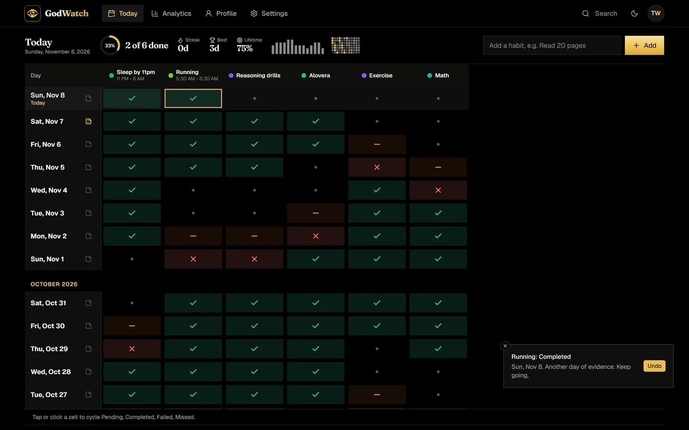
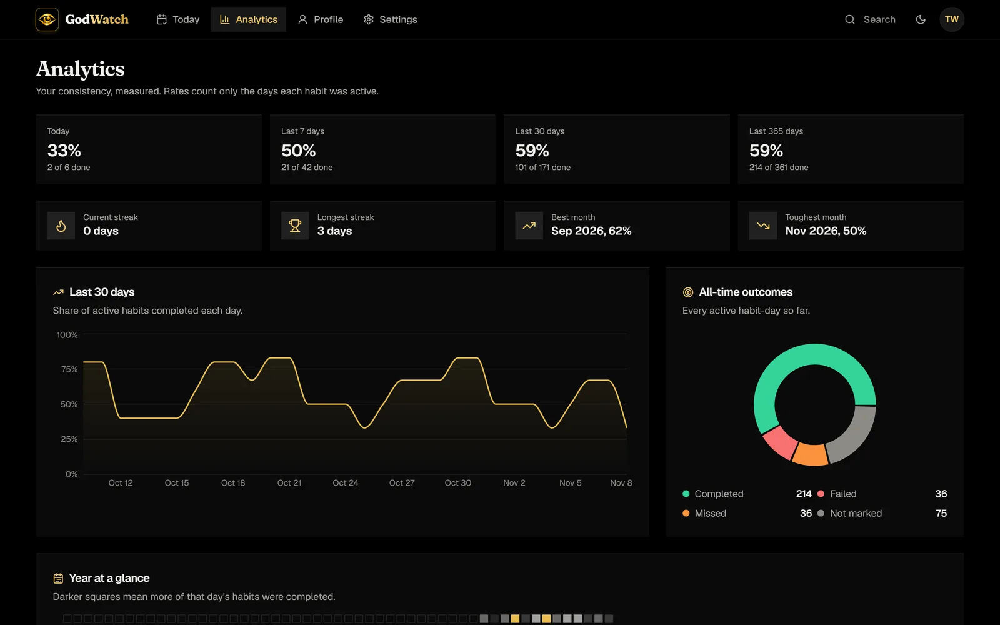
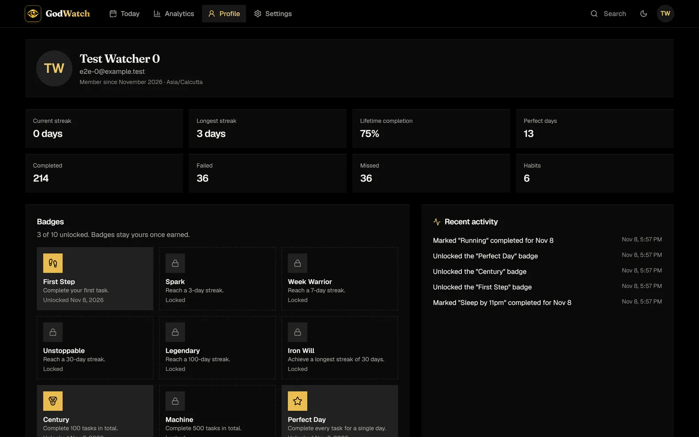
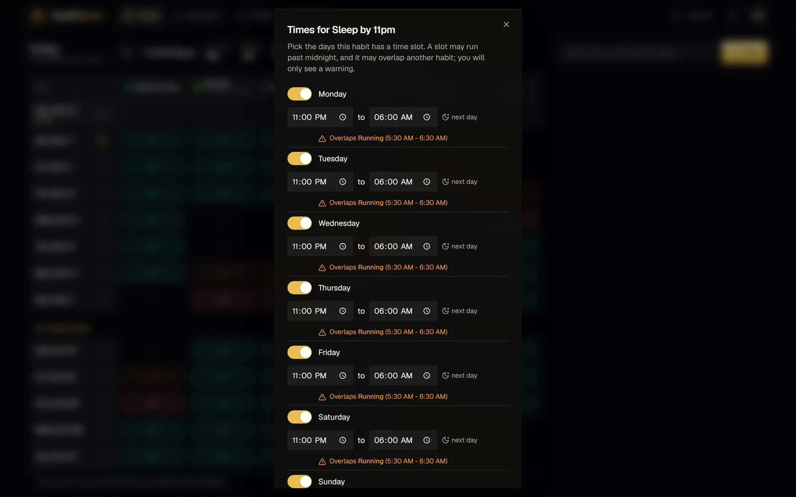
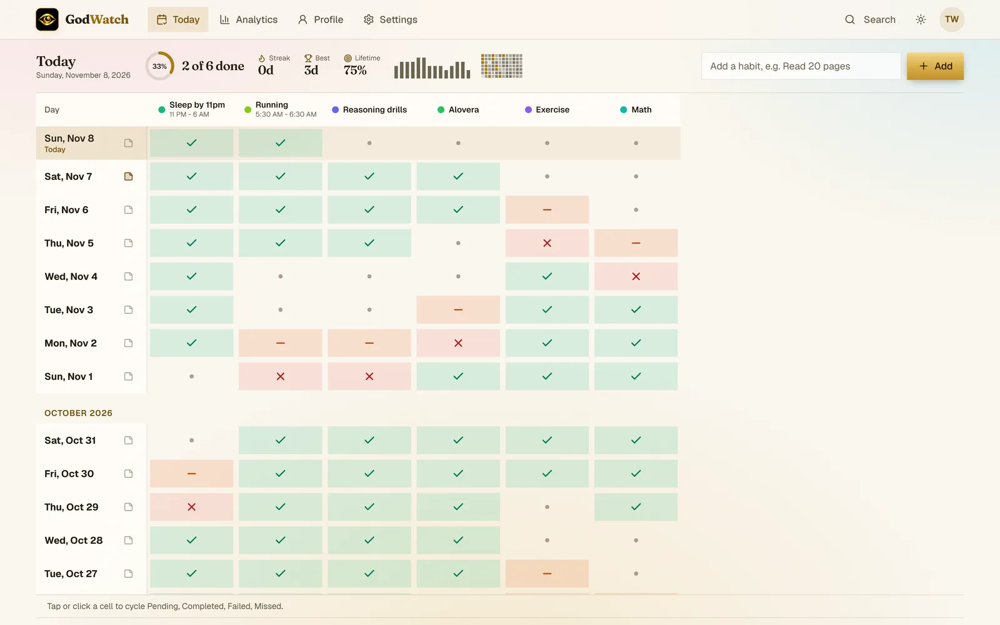
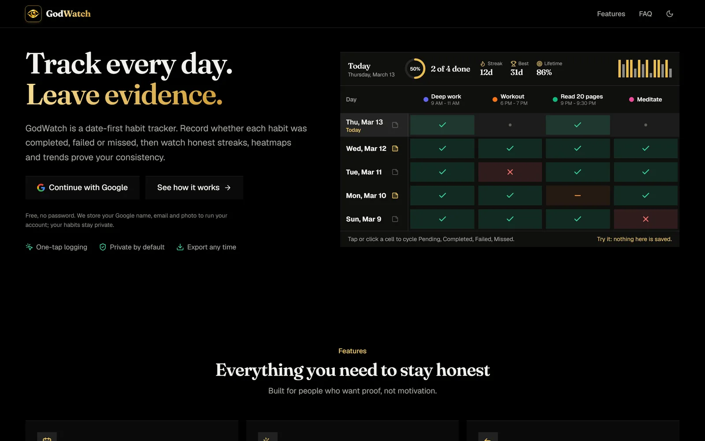
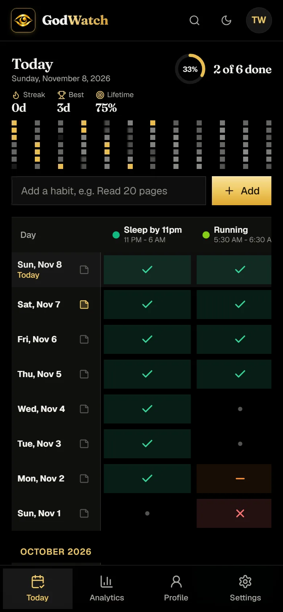

<p align="center">
  <a href="https://godwatch.vercel.app">
    
  </a>
</p>

<h1 align="center">GodWatch</h1>

<p align="center"><strong>Every Day Leaves Evidence.</strong></p>

<p align="center">
  A date-first habit tracker. Every day is a row, every habit a column, and every cell is a verdict:
  <br />
  <em>Completed, Failed or Missed.</em> No streak theatre, no motivational fluff. Just the record.
</p>

<p align="center">
  <a href="https://godwatch.vercel.app"></a>
</p>

<p align="center">
  
  
  
  
  
  
  
  
</p>

<p align="center">
  
</p>

---

## Why GodWatch

Most habit apps ask "did you do it?" and give you a checkbox. GodWatch asks a harder question: **what actually happened today?**

- **Three honest answers.** Completed, Failed, Missed. A failed day and a forgotten day are different things, and your analytics should know it.
- **Date-first.** Today is the top row. Scroll down and you are reading your own history, one day per line, months of it.
- **One click per cell.** Click to cycle the status. It saves instantly. Undo from the toast if you slip.
- **Fair streaks.** A habit only counts from the day you created it. Adding a new habit never rewrites your past.
- **Yours.** Private by default, exportable any time as CSV, JSON or PDF. Sign in with Google, nothing else to remember.

## A closer look

<table>
  <tr>
    <td width="50%" valign="top">
      
      <p align="center"><strong>Analytics that tell the truth</strong><br />7 / 30 / 365-day rates, streaks, best and toughest month, a 30-day trend, all-time outcomes and a year heatmap.</p>
    </td>
    <td width="50%" valign="top">
      
      <p align="center"><strong>Badges for the record</strong><br />Ten achievements, from your first mark to a 100-day streak. Once earned, they stay.</p>
    </td>
  </tr>
  <tr>
    <td width="50%" valign="top">
      
      <p align="center"><strong>Habit times, even overnight</strong><br />Give each weekday a window. "11 PM to 6 AM" just works, and an overlap with another habit is a warning, never a wall.</p>
    </td>
    <td width="50%" valign="top">
      
      <p align="center"><strong>Light or dark, one tap</strong><br />A warm paper theme by day, true black by night. The gold eye reads the same on both.</p>
    </td>
  </tr>
</table>

<table>
  <tr>
    <td width="68%" valign="top">
      
      <p align="center"><strong>Sign in from the front door</strong><br />The landing page carries a live, clickable miniature of the grid and a single Google button. No second page, no password.</p>
    </td>
    <td width="32%" valign="top">
      
      <p align="center"><strong>Install it anywhere</strong><br />A PWA with a bottom tab bar on phones. Nothing private is cached on the device.</p>
    </td>
  </tr>
</table>

## Everything it does

| | Feature | Detail |
|---|---|---|
| 📅 | **Date-first grid** | Today on top, 90 days by default, "Show earlier days" for the rest. Month headers as you scroll. |
| 🖱️ | **One click per day** | Click a cell to cycle Pending → Completed → Failed → Missed. Saves instantly, with Undo. |
| ⏰ | **Habit times** | A time window per weekday. The next habit can start when the previous one ends. Overnight windows are fine. |
| 🔔 | **Alerts when a habit starts** | Web Push to every device you have registered, the moment a timed habit begins. |
| 🕗 | **Daily check-in reminder** | An optional browser notification at the time you choose. |
| 🔥 | **Fair streaks** | A perfect day is every active habit completed. An unfinished today never breaks your streak. |
| 🏅 | **Badges** | Ten achievements, unlocked automatically and kept for good. |
| 📊 | **Analytics** | Today / 7 / 30 / 365-day rates, streaks, best and toughest month, trend line, outcomes donut, year heatmap, per-habit breakdown. |
| 📝 | **Daily notes** | One autosaving note per day. Searchable. |
| 🔎 | **Search** | Habits, notes and days from one box. |
| 🗂️ | **Archive, never erase** | Retire a habit and its history stays. Restore it from Settings. |
| ⬇️ | **Export** | The last 365 days as CSV, JSON or a clean PDF report. |
| 📱 | **PWA** | Installable on phone and desktop. Offline page. Only public static files are cached. |
| 🔒 | **Private by default** | Google sign-in, verified emails only. Your data is scoped to you and never shared. |

## How days and streaks are counted

- "Today" is *your* day, in your time zone, detected from the browser and stored in Settings.
- A habit counts from the day it was created (or the earliest day you back-filled) until the day it was archived.
- A day is **perfect** when it has at least one active habit and every active habit is Completed. Streaks count consecutive perfect days.
- Adding a habit never changes how past days score.

The engine is pure and unit-tested: `src/lib/stats.ts`, `src/lib/dates.ts`, `src/lib/schedule.ts`.

## Under the hood

| Layer | Choice |
|---|---|
| Framework | Next.js 15 App Router, React 19, Server Actions, TypeScript strict |
| Styling | Tailwind CSS 4, Fraunces + Geist via `next/font`, light and dark themes |
| Data | Prisma on Neon Postgres (pooled + direct URLs) |
| Auth | Auth.js v5, Google only, JWT sessions re-checked against the database |
| Push | Web Push (VAPID) + a cron endpoint for habit-start alerts |
| Quality | Vitest unit tests, Playwright e2e against an in-memory Postgres (PGlite), axe accessibility checks, ESLint with zero warnings |
| Hosting | Vercel (Singapore region), migrations run at build |

### Security, briefly

Per-request nonce Content-Security-Policy plus HSTS, frame, content-type, referrer and permissions headers. Every query is scoped to the signed-in user's id from the session, never from client input. Zod validation on every server action. Postgres-backed rate limits that hold across serverless instances. Same-origin-only redirects after sign-in. CSV export neutralises spreadsheet formulas. The service worker never caches signed-in pages or API responses.

## Run it yourself

```bash
git clone https://github.com/DevnetraConsultancy/GodWatch.git
cd GodWatch
npm install
cp .env.example .env        # Google OAuth client, Neon URLs, Auth.js secret, VAPID keys
npx prisma migrate deploy   # create tables
npm run db:seed             # badge definitions
npm run dev
```

| Command | What it does |
|---|---|
| `npm run dev` | Development server |
| `npm run build` | Prisma generate + production build |
| `npm run typecheck` | TypeScript, strict |
| `npm run lint` | ESLint, zero warnings allowed |
| `npm test` | Unit tests (Vitest) |
| `npm run test:e2e` | End-to-end tests. Starts its own app and throwaway database. |
| `npm run check` | Type check, lint, unit tests and build |
| `npm run db:migrate` | Create a new migration in development |
| `npm run db:deploy` | Apply migrations (production) |

Set `E2E_PROD=1` to run the e2e suite against `next start` (build first). For a design review with realistic data, `node tests/e2e/demo-stack.mjs` boots the app on port 3100 with six habits and five weeks of history.

### Deploying (Vercel + Neon)

1. Create a Neon project and copy the pooled and direct connection strings.
2. Set the variables from `.env.example` in Vercel.
3. Vercel runs `prisma migrate deploy && npm run build` (see `vercel.json`).
4. Add `{your domain}/api/auth/callback/google` as an authorised redirect URI in Google Cloud Console.
5. Point an external scheduler at `/api/push/cron` every few minutes with `Authorization: Bearer $CRON_SECRET` for habit-start alerts.

## Project structure

```
src/
  app/            routes: landing (with Google sign-in), (app)/dashboard|analytics|profile|settings, api/
  components/ui/  design system: buttons, fields, cards, dialogs, menus, tabs, tooltips, tables, states
  features/       grid, analytics, profile, settings, search, shell, reminders, push, landing, pwa, auth
  server/         auth, database, session, rate limiting, data access, server actions (server-only)
  lib/            pure logic: dates, stats, schedule, status, achievements, export, validation
prisma/           schema, migrations, seed
tests/unit        Vitest
tests/e2e         Playwright, with an in-memory Postgres stack and a demo-data stack
docs/screenshots  the images on this page
```

---

<p align="center">
  <br />
  <strong>Invented with ❤️ by <a href="mailto:devnetraconsultancy@gmail.com">Devnetra Consultancy</a></strong><br />
  <sub>Products that leave evidence. Say hello: <a href="mailto:devnetraconsultancy@gmail.com">devnetraconsultancy@gmail.com</a></sub><br /><br />
  <sub>© Devnetra Consultancy. All rights reserved.</sub>
</p>
